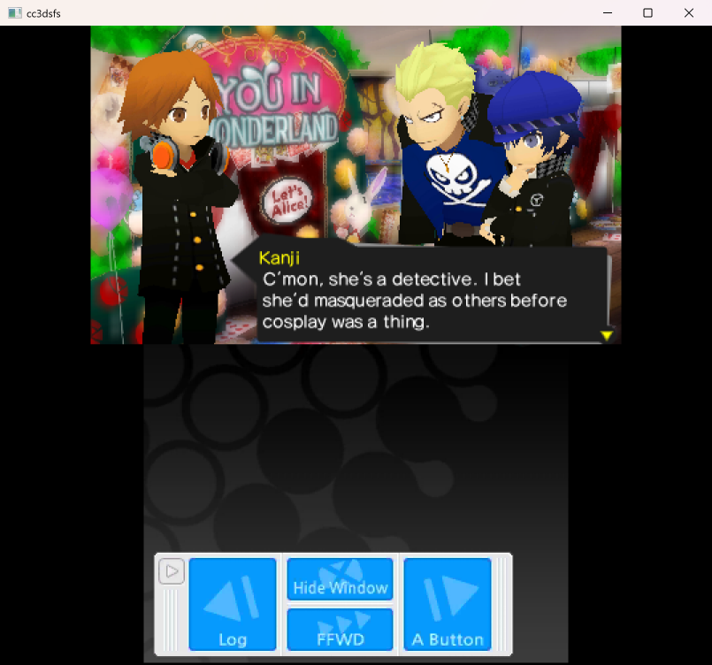
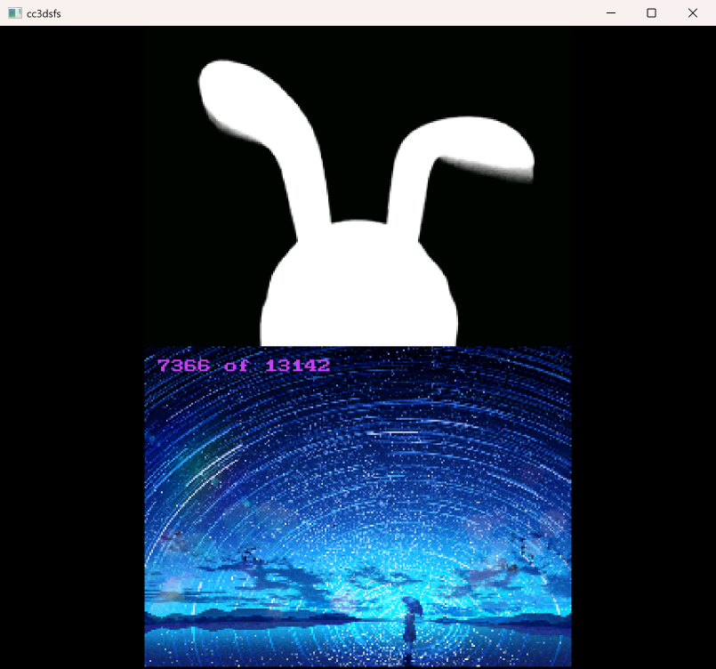
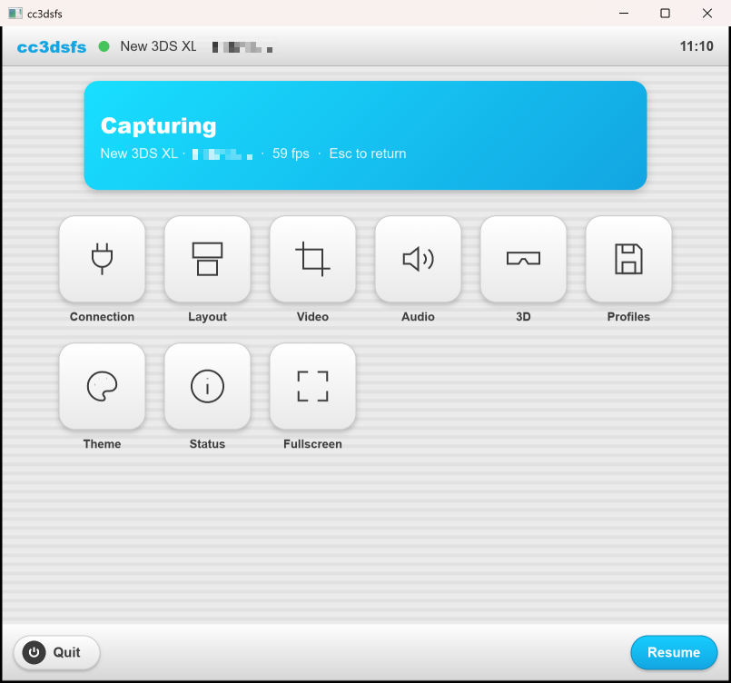
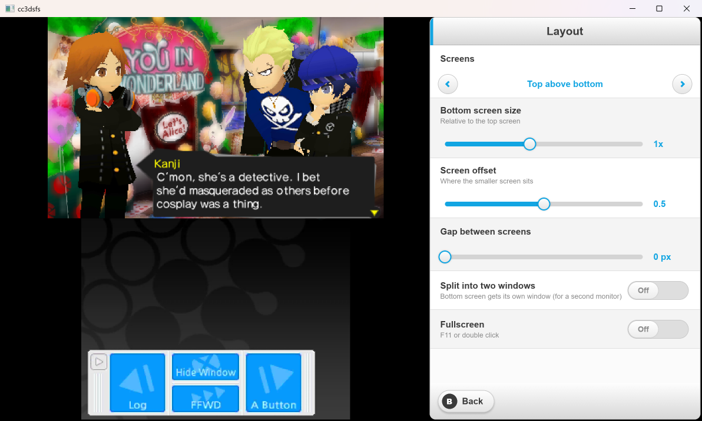
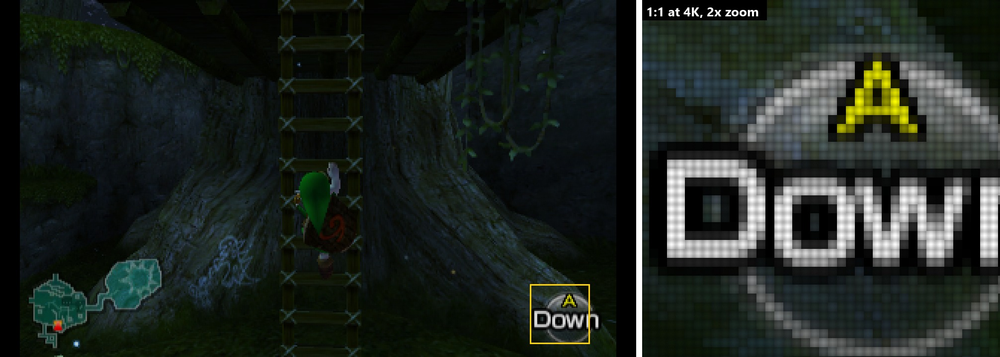
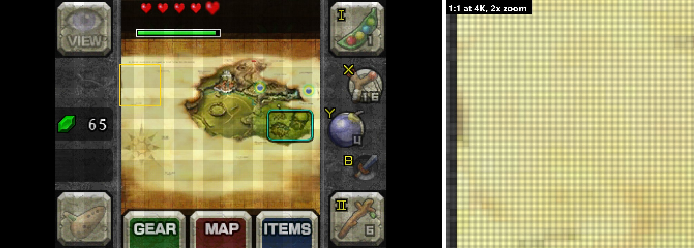
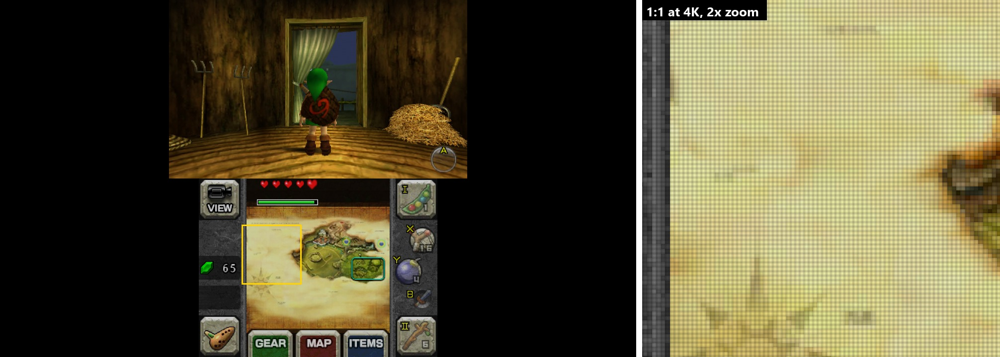
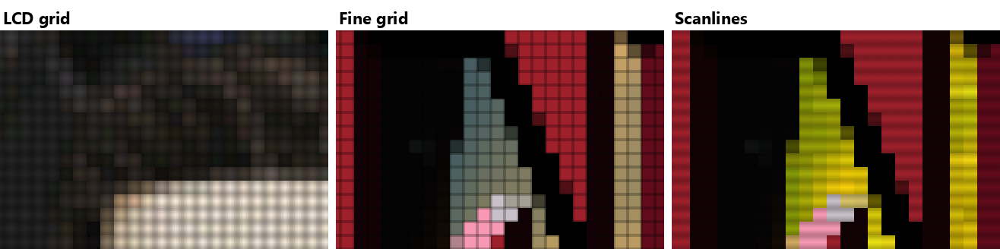

# cc3dsfs (Rust edition)

A Windows viewer for [Loopy's](https://3dscapture.com/) 3DS and DS capture boards, with a UI styled after the 3DS HOME Menu.

This is a Rust rewrite of [cc3dsfs](https://github.com/Lorenzooone/cc3dsfs) by Lorenzooone. The capture code is a port of the original's Loopy device code. The interface is built with [Slint](https://slint.dev).

| Capturing a New 3DS XL (integer scaling) | Capturing a DS (older board) |
|---|---|
|  |  |

| HOME Menu (Esc or right click) |
|---|
|  |

## Supported boards

| Board | Driver on Windows |
|---|---|
| New 3DS XL (2020+, FT601) | FTDI D3XX (default) or WinUSB |
| 3DS (older boards) | WinUSB |
| DS (older boards) | WinUSB |
| DS (2024 boards, FT232H) | FTDI D2XX (default) |

- The FTDI DLLs (`FTD3XX.dll`, `ftd2xx.dll`) are copied next to the executable when you build.
- You still need the board's driver installed. If an older board isn't detected, use [Zadig](https://zadig.akeo.ie/) to install the WinUSB driver for it.
- 3D capture needs a New 3DS XL board with 3D support, on a USB 3 port.

## Features

- Connects automatically and reconnects after you unplug the board.
- Live preview: while capturing, the Layout, Video and 3D pages open as a side panel next to the game, so you see each change as you make it.
- Layouts:
  - Top above bottom, bottom above top, side by side (either order), top only or bottom only.
  - Adjustable bottom screen size, screen offset and gap between screens.
- Split mode: the bottom screen opens in its own window, which you can put on a second monitor.
- Fullscreen, integer scaling and optional smoothing.
- The built-in crops from the original (DS, GBA, Virtual Console), plus optional game-specific crops.
- Screen rotation for each screen.
- Audio with volume, mute and output device selection, tuned for low latency.
- 3D capture, shown as the left eye only or side by side.
- 4 profile slots; settings are saved automatically.
- Seven console-colour themes.

## Layout and Video

While capturing, the Layout and Video pages open as a panel next to the game. The game stays live, so each change shows on screen as you make it.

**Layout** sets how the screens are arranged, the bottom screen's size and position, the gap between the screens, split windows and fullscreen.



**Video** sets the crop, game-specific crops, integer scaling, smoothing and rotation for each screen.


The 3D page opens the same way. Narrow windows put the panel along the bottom instead.

## Top, bottom and both screens with the LCD grid

These were captured from a New 3DS XL, fullscreen on a 4K monitor, with the **LCD grid** filter at its default 30%. Each image has the whole 3840×2160 frame (scaled down) on the left, and a 1:1 close-up from the yellow box, zoomed 2×, on the right. The grid only shows at full size.

**Top screen** (Game Sack: Top screen preset, 9×). One grid cell per 3DS pixel.



**Bottom screen** (Game Sack: Bottom screen preset, 9×).



**Both screens** (Game Sack: Both screens preset, 4.5×). Each 3DS pixel is 4.5 screen pixels here, and the grid still follows it on both screens.



## Presets and screen filters

### Presets

**HOME Menu → Presets** sets up the screens in one click. Like Layout and Video, the page opens next to the live game.

| Preset | Screens | On a 4K display |
|---|---|---|
| Game Sack: Top screen | Top only, integer scaling, LCD grid | 9×, 3600×2160 |
| Game Sack: Bottom screen | Bottom only, integer scaling, LCD grid | 9×, 2880×2160 |
| Game Sack: Both screens | Top above bottom, filling the height, LCD grid | 4.5× |
| Game Sack: Hinge gap | Same, with a 28-pixel gap for the hinge | ≈4.25× |
| Morph 4K: Top / Bottom / Both / Hinge | The same four layouts, integer scaling, filter off | for a 1080p output |

The **Game Sack** presets recreate the 3DS views in Game Sack's [The Nintendo 3DS](https://www.youtube.com/watch?v=NdBrv1r_jZE). Use them with cc3dsfs fullscreen on a 4K display. Measured at 4K, the screens land where they are in that video:

- top screen at x 120–3719;
- bottom screen at x 480–3359;
- both screens with the top at x 1020–2819;
- hinge gap of about 120 px.

The **Morph 4K** presets are for sending 1080p to a Morph 4K, which then does the 4K scaling and the grid. They match the presets in [morph4k-profile-test](https://github.com/The1Azreen/morph4k-profile-test).

Presets change only screen settings: layout, gap, scaling, filter, crop and rotation. Audio, theme and connection settings stay as they are.

### Screen filters

**Video → Screen filter** draws a filter over each screen:

- **LCD grid**: a soft dark grid between pixels, the same in red, green and blue. The profile was measured from Game Sack's 4K footage of the 3DS. The default 30% strength matches it.
- **Fine grid**: thin, sharp lines between pixels, like the Morph 4K's PSP and Vita masks.
- **Scanlines**: horizontal lines only.



The filter follows each screen's own pixels. It stays aligned in every layout and screen position, and with crops, rotation, the bottom screen size slider and split windows. It also works at fractional scales such as the 4.5× both-screens view.

It turns itself off when a 3DS pixel is smaller than 3 screen pixels, where a grid would only cause moiré. In practice it needs a large window or fullscreen on a 1440p or 4K display.

### HDR output (Windows)

A screen filter darkens the picture. The Morph 4K and RetroTINK 4K make up for that with HDR injection: they send the game to the TV as HDR, so it can be brighter than normal (SDR) white. cc3dsfs can do the same on Windows.

Turn on **Video → HDR output**.

- While you're capturing with the menu closed, cc3dsfs shows the game in an HDR window, fullscreen on the same monitor.
- **HDR brightness** sets the white level in nits (default 300). cc3dsfs then raises it further, by however much the screen filter darkens the picture.
- Highlights roll off softly below the monitor's peak brightness instead of clipping.
- **Esc** or a right click in the HDR window opens the HOME Menu. Closing the menu brings the HDR window back.

It needs Windows' **Use HDR** setting on for that monitor. The Video page shows whether it is, and the monitor's peak brightness.

Measured on a 4K HDR monitor, with the Top screen preset, the LCD grid at 30%, and the same frames in both runs:

| | Average | Brightest 1% | Peak |
|---|---|---|---|
| Normal (SDR) window | 43 nits | 126 nits | 171 nits |
| HDR output, 300 nits | 102 nits | 307 nits | 409 nits |

The grid looks the same in both.

Not available on the Raspberry Pi kiosk. Its display output is SDR only, so for HDR on the Pi, use the Morph 4K's own HDR injection.

## Controls

| Input | Action |
|---|---|
| Esc / right click / HOME button | Open or close the HOME Menu |
| F11 / Alt+Enter / double click | Toggle fullscreen |
| M | Mute |

Settings and profiles are stored in `%APPDATA%\cc3dsfs`.

## Building

1. Install [Rust](https://rustup.rs/) (MSVC toolchain).
2. Build:

```
cargo build --release
```

The program, `FTD3XX.dll` and `ftd2xx.dll` end up in `target\release`. Keep the DLLs next to `cc3dsfs.exe` when you move it.

Tests: `cargo test`. Debug builds also have a fake board for trying out layouts without hardware: set `CC3DSFS_DEMO=1` before running.

## Project layout

- `src/capture/`: device discovery and capture.
  - `ftd3.rs`: New 3DS XL boards.
  - `legacy_usb.rs`: older 3DS and DS boards.
  - `ftd2.rs`: 2024 DS boards.
  - `frame.rs`: frame decoding.
- `src/audio.rs`: resampling and low-latency output.
- `src/view.rs`: crop table and rotation.
<<<<<<< Updated upstream
- `ui/`: the Slint UI. `theme.slint` holds the 3DS-style components; `app.slint` holds the windows and pages.
=======
- `src/presets.rs`: the Game Sack and Morph 4K presets.
- `src/layout.rs`: screen placement maths, shared with the HDR window.
- `src/hdr.rs`, `src/hdr.hlsl`: the Windows HDR output window (Direct3D 11, scRGB).
- `ui/`: the Slint UI. `theme.slint` holds the 3DS-style components; `filter.slint` draws the screen filters; `app.slint` holds the windows and pages.
- `pi/`: Raspberry Pi kiosk installer, launcher, systemd service and udev rules.
>>>>>>> Stashed changes

## Not ported (yet)

Compared to the original cc3dsfs, this version doesn't have:

- Linux, macOS and Android builds.
- Non-Loopy devices: IS Nitro/TWL, Optimize, Partner CTR, Nisetro.
- WinUSB support for the 2024 DS boards.
- Colour correction, BFI, PAR and the output framerate settings. The original's shaders are replaced by the screen filters above.

## Acknowledgements

This project is based on [cc3dsfs](https://github.com/Lorenzooone/cc3dsfs), created by **[Lorenzooone](https://github.com/Lorenzooone)**. It is a derivative work of cc3dsfs, which is licensed under the MIT License.

- The capture code is a port of cc3dsfs's Loopy device code. That covers the USB protocols for the New 3DS XL, older 3DS/DS and 2024 DS boards, plus frame decoding and audio handling.
- The crop presets and the screen layout behaviour come from cc3dsfs.
- Lorenzooone's original copyright notice and the MIT permission notice are kept, unmodified, in [LICENSE](LICENSE), as the MIT License requires.

Thanks also to **Loopy** ([3dscapture.com](https://3dscapture.com/)), whose capture boards this supports. The board communication code is based on Loopy's sample code, and Loopy provided the DS FPGA bitstreams in `firmware/`.

## Licenses

- MIT, see [LICENSE](LICENSE). The original cc3dsfs is Copyright (c) 2024 Lorenzooone.
- The DS FPGA bitstreams in `firmware/` were provided by Loopy; see [other licenses/bin_files.txt](other%20licenses/bin_files.txt).
- The FTDI driver libraries are covered by [FTDI's licence](ftdi_lib_files/ftd2xx_ftd3xx_license.txt).
- The UI uses Slint under its Royalty-free license.
